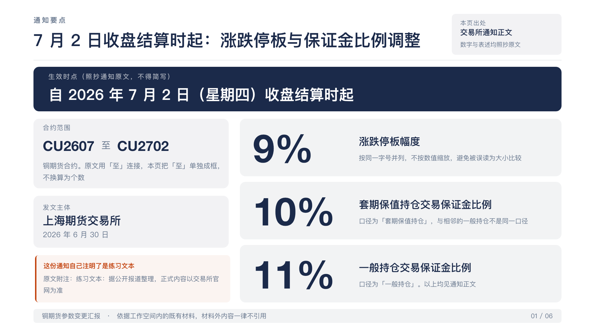
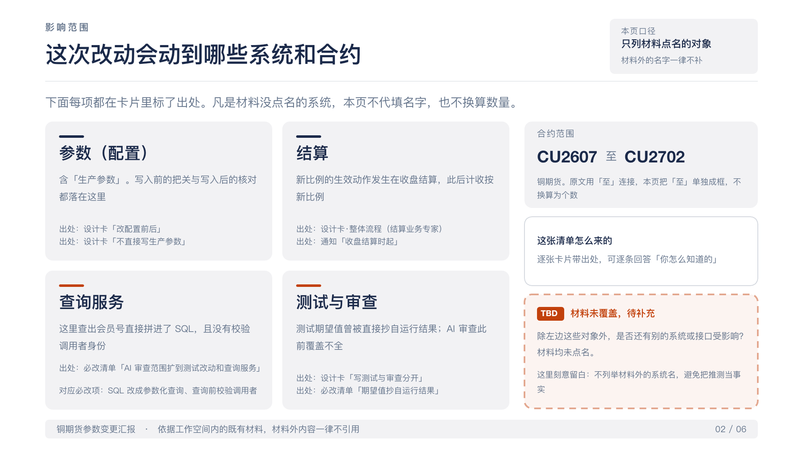
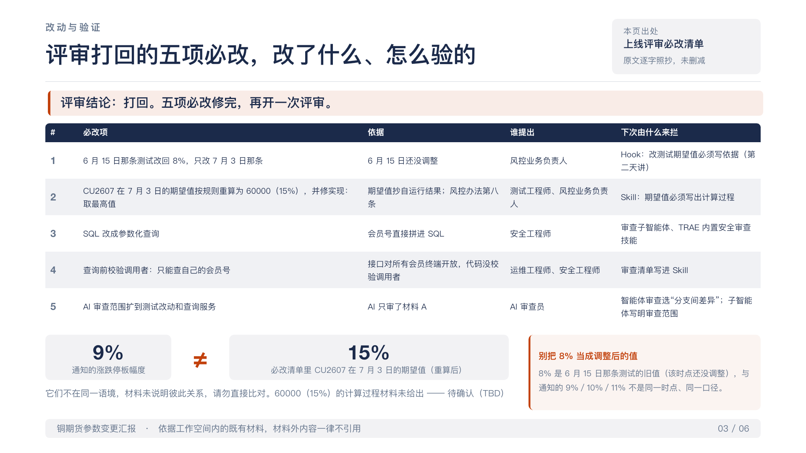
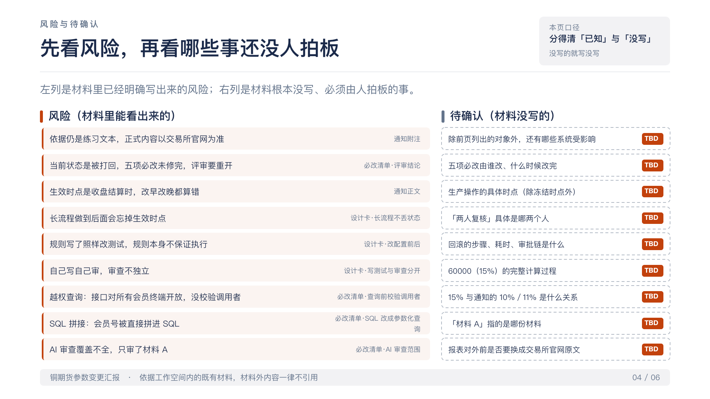
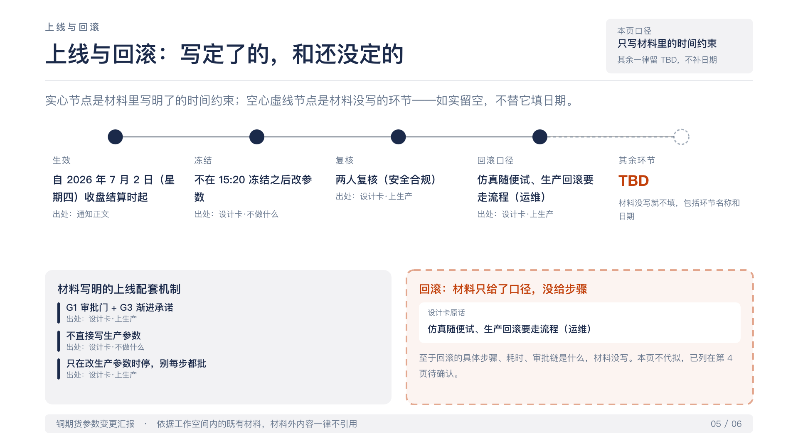
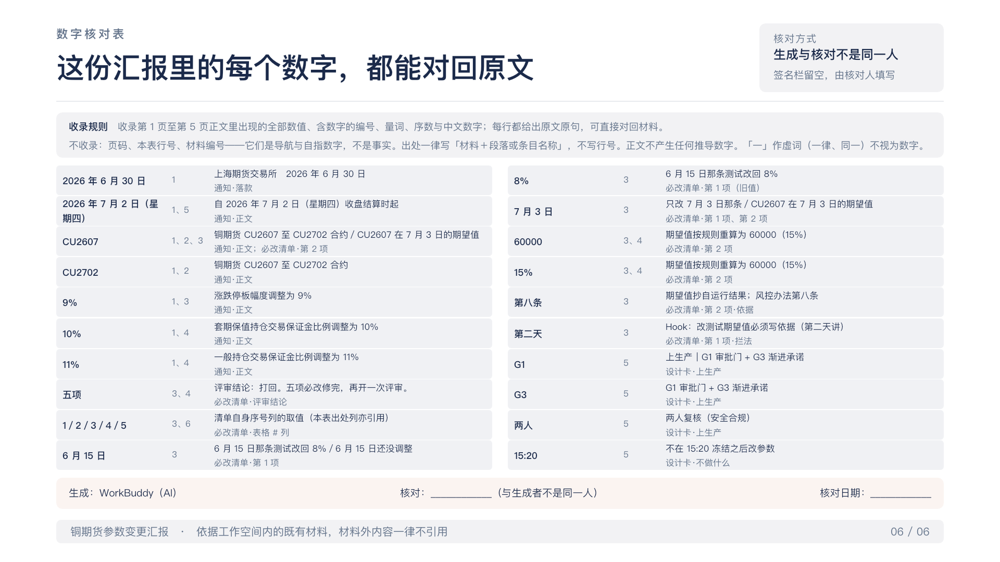

# 动手七：示例成品

WorkBuddy 用同一批练习材料真实跑出来的一份五页汇报，最后一页是数字核对表。课上自己的任务还没跑完时，先核对这一份。

核对五样：三个比例和通知一致；“自 7 月 2 日收盘结算时起”没被改写成“7 月 2 日起”；合约范围是 CU2607 至 CU2702；有数字核对表，每个数字写了出处；图表是可编辑的形状，不是截图。每条记录写下原文怎么说、成品怎么写、改还是不改。

- [workbuddy-example.pptx](workbuddy-example.pptx)

